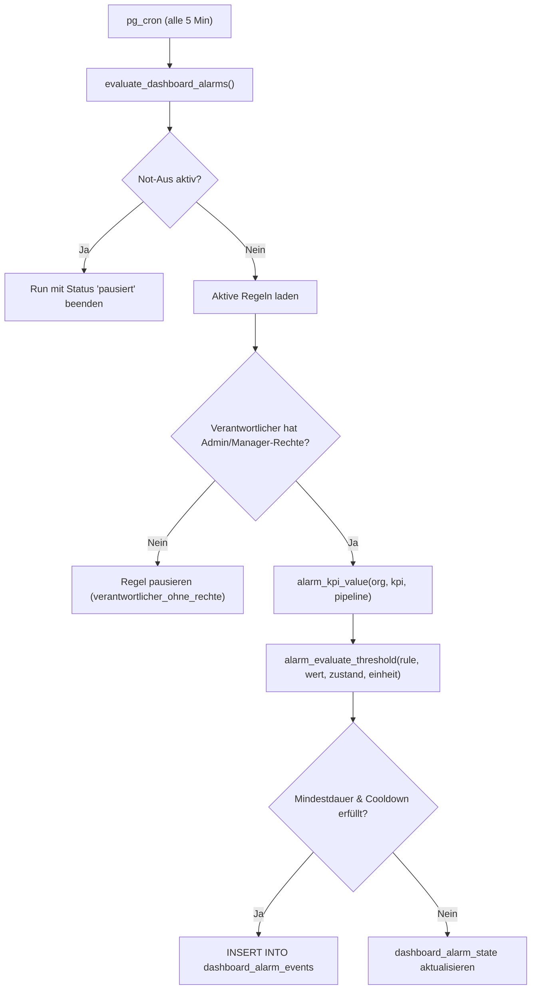
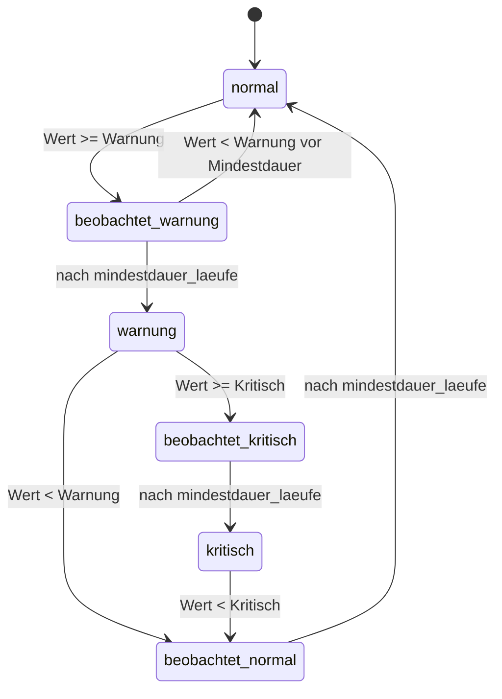

# Server-Alarme mit pg_cron (P13b / Auftrag 167)

Dieses Dokument beschreibt die Server-Architektur für Schwellenwert-Alarme im LeadPilot Dashboard-Editor gemäß Auftrag 167 (Paket P13b, Entscheidung vom 18.11.2026).

---

## 1. Architektur-Übersicht

Alarme werden serverseitig in der PostgreSQL-Datenbank über die Erweiterung `pg_cron` alle 5 Minuten evaluiert.
Die Auswertung erfolgt mandantenisoliert, zustandsbehaftet mit zeitlicher Hysterese (Mindestdauer) und Abklingzeit (Cooldown).



---

## 2. Tabellen

| Tabelle | Zweck | RLS / Schutz |
| --- | --- | --- |
| `public.alarm_settings` | Globale Steuerparameter, Not-Aus (`auswertung_aktiv`) | RLS aktiv, keine direkten Client-Grants |
| `public.dashboard_alarm_rules` | Konfigurierte Schwellenwert-Regeln je Dashboard & Kachel | RLS aktiv, SELECT für Mitglieder, Schreibzugriff nur via RPC |
| `public.dashboard_alarm_state` | Aktueller Zustand (beobachtete vs. bestätigte Stufe, Zähler, Cooldown) | RLS aktiv, nur Worker schreibt |
| `public.dashboard_alarm_events` | Unveränderliches Ereignisprotokoll | RLS aktiv, INSERT-only durch Worker, keine Client-Writes |
| `public.alarm_worker_runs` | Lebenszeichen & Laufprotokoll der Ausführungen | RLS aktiv, Auswertung über `alarm_worker_status()` |

---

## 3. Zustandsmodell & Hysterese



- **Mindestdauer (`mindestdauer_laeufe`):**
  Erst wenn ein Zustand über `N` aufeinanderfolgende Worker-Läufe stabil beobachtet wurde, wird die Stufe bestätigt und ein Ereignis generiert. Bei `mindestdauer_laeufe = 1` erfolgt der Wechsel sofort.
- **Abklingzeit (`abklingzeit_sekunden`):**
  Verhindert Alarmfluten bei oszillierenden Werten. Nach einem generierten Ereignis wird für dieselbe Stufe innerhalb des Cooldown-Fensters kein weiteres Ereignis ausgelöst.
  *Ausnahme:* Eine Eskalation zu `kritisch` durchbricht die Abklingzeit unmittelbar.

---

## 4. Berechtigungen & RPCs

Regeln dürfen nur von **Admins** und **Managern** der jeweiligen Organisation verwaltet werden:

| RPC | Berechtigung | Beschreibung |
| --- | --- | --- |
| `create_dashboard_alarm_rule` | Admin, Manager | Erstellt oder aktualisiert Alarmregel für Kachel |
| `update_dashboard_alarm_rule` | Admin, Manager | Ändert Regelkonfiguration oder Hysterese |
| `pause_dashboard_alarm_rule` | Admin, Manager | Pausiert eine Regel manuell |
| `resume_dashboard_alarm_rule` | Admin, Manager | Setzt Regel fort (prüft Rechte des Verantwortlichen) |
| `takeover_dashboard_alarm_rule` | Admin, Manager | Übernimmt Verantwortung und aktiviert verwaiste Regel |
| `delete_dashboard_alarm_rule` | Admin, Manager | Löscht Regel kaskadierend mit State und Events |
| `list_dashboard_alarm_rules` | Aktives Mitglied | Listet alle Regeln des Dashboards inkl. aktuellem State |
| `list_dashboard_alarm_events` | Aktives Mitglied | Paginierte Ereignishistorie |
| `alarm_worker_status` | Authenticated | Prüft Lebenszeichen des Workers (`ok`, `ueberfaellig`, `pausiert`) |

---

## 5. Paritätsnachweis je Kennzahl

Alle 16 freigegebenen Kennzahlen besitzen nachgewiesene Parität zwischen Client-Berechnung (`evaluateThresholdV2`) und Datenbank (`alarm_kpi_value` + `alarm_evaluate_threshold`):

| Kennzahl-ID | Typ | Einheit | Serverquelle | Paritätsnachweis |
| --- | --- | --- | --- | --- |
| `crm.pipeline_deals` | CRM | Stück | RPC `dashboard_crm_pipeline_overview_for_org` | `dashboard_alarm_parity.sql` |
| `crm.pipeline_volumen` | CRM | EUR | RPC `dashboard_crm_pipeline_overview_for_org` | `dashboard_alarm_parity.sql` |
| `crm.pipeline_gewonnen` | CRM | EUR | RPC `dashboard_crm_pipeline_overview_for_org` | `dashboard_alarm_parity.sql` |
| `crm.pipeline_offen` | CRM | EUR | RPC `dashboard_crm_pipeline_overview_for_org` | `dashboard_alarm_parity.sql` |
| `live.arr` | Live | EUR | Tabelle `public.live_kpi_public_feed` | `dashboard_alarm_parity.sql` |
| `live.mrr` | Live | EUR | Tabelle `public.live_kpi_public_feed` | `dashboard_alarm_parity.sql` |
| `live.pipeline_coverage` | Live | x | Tabelle `public.live_kpi_public_feed` | `dashboard_alarm_parity.sql` |
| `live.arr_direct` | Live | EUR | Tabelle `public.live_kpi_public_feed` | `dashboard_alarm_parity.sql` |
| `live.arr_partner` | Live | EUR | Tabelle `public.live_kpi_public_feed` | `dashboard_alarm_parity.sql` |
| `live.arr_outbound` | Live | EUR | Tabelle `public.live_kpi_public_feed` | `dashboard_alarm_parity.sql` |
| `live.arr_other` | Live | EUR | Tabelle `public.live_kpi_public_feed` | `dashboard_alarm_parity.sql` |
| `live.pipeline_leads` | Live | Stück | Tabelle `public.live_kpi_public_feed` | `dashboard_alarm_parity.sql` |
| `live.pipeline_mql` | Live | Stück | Tabelle `public.live_kpi_public_feed` | `dashboard_alarm_parity.sql` |
| `live.pipeline_sql` | Live | Stück | Tabelle `public.live_kpi_public_feed` | `dashboard_alarm_parity.sql` |
| `live.pipeline_offers` | Live | Stück | Tabelle `public.live_kpi_public_feed` | `dashboard_alarm_parity.sql` |
| `live.pipeline_won` | Live | Stück | Tabelle `public.live_kpi_public_feed` | `dashboard_alarm_parity.sql` |

---

## 6. Revisions- & Ereignis-Aufbewahrung

- **Revisionen:** Täglicher Job (`cleanup_dashboard_revisions()`) bereinigt Revisionen, wenn:
  1. Revision > 1 (Revision 1 bleibt stets erhalten),
  2. Älter als 12 Monate,
  3. Nicht innerhalb der letzten 100 Revisionen des Dashboards (`rn > 100`),
  4. Nicht als Wiederherstellungsquelle (`Wiederherstellung von Revision X`) referenziert.
- **Alarmereignisse:** Täglicher Job (`cleanup_dashboard_alarm_events()`) löscht Ereignisse, die älter als 12 Monate sind.

---

## 7. Betriebsanleitung für Marc (Hosted Projekt)

Nach dem Merge von PR #206 im Produktiv- bzw. Hosted-Projekt:

1. **Erweiterung aktivieren:**
   Prüfe im Supabase Dashboard unter *Database -> Extensions*, dass `pg_cron` aktiv ist.

2. **Migration anwenden:**
   Migration `supabase/migrations/20261124_dashboard_alarms.sql` über CLI oder Migrationspipeline ausrollen.

3. **Jobs prüfen:**
   ```sql
   SELECT jobid, jobname, schedule, active FROM cron.job;
   ```
   Erwartung:
   - `dashboard-alarms-eval`: alle 5 Minuten (`*/5 * * * *`), `active = true`
   - `dashboard-daily-cleanup`: täglich um 03:00 Uhr (`0 3 * * *`), `active = false` (wird erst nach manueller Freigabe aktiviert)

4. **Lebenszeichen prüfen:**
   ```sql
   SELECT public.alarm_worker_status();
   ```
   Liefert `{"status": "ok", ...}` sobald der erste Lauf durch ist.

5. **Not-Aus (Kill Switch):**
   - *Auswertung sofort stoppen:*
     ```sql
     UPDATE public.alarm_settings SET auswertung_aktiv = false;
     ```
   - *Auswertung reaktivieren:*
     ```sql
     UPDATE public.alarm_settings SET auswertung_aktiv = true;
     ```
